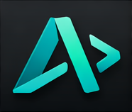
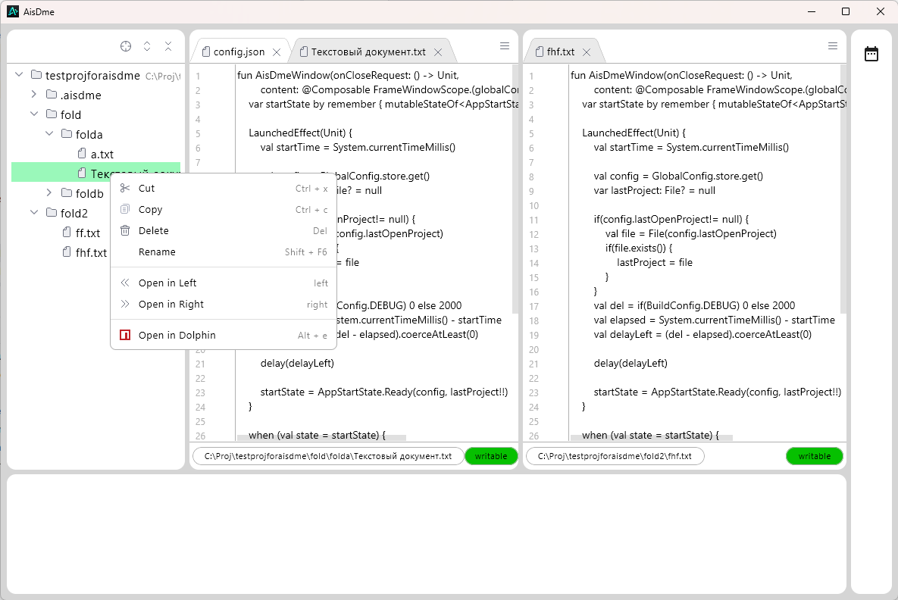

# AisDme

Учебный редактор на Kotlin и Compose for Desktop. Хобби-проект, в разработке.

<br clear="left">



## Что уже есть

- Дерево проекта: создание, переименование, удаление, копирование и перемещение файлов, drag & drop, «показать в файловом менеджере»
- Обновление дерева при изменениях на диске
- Редактор текста с вкладками в двух половинах экрана, номера строк
- Просмотр изображений
- Сохранение состояния: открытые вкладки, раскрытые папки, размер и положение окна
- Своя тема и свои скроллбары

## Сборка и запуск

Нужен JDK 17. Работает на Linux, Windows.

```
./gradlew run               # запуск, debug-сборка
./gradlew run -Prelease     # запуск, release-сборка
./gradlew build             # сборка
```

## Стек

Kotlin 1.9, Compose for Desktop 1.6, kotlinx-coroutines, kotlinx-serialization, Gradle (Kotlin DSL).

## Лицензия

Код — [MIT](LICENSE).

Иконки в `src/main/resources/icons/` — [IntelliJ Platform Icons](https://intellij-icons.jetbrains.design), © JetBrains s.r.o. and contributors, [Apache 2.0](src/main/resources/icons/LICENSE).
