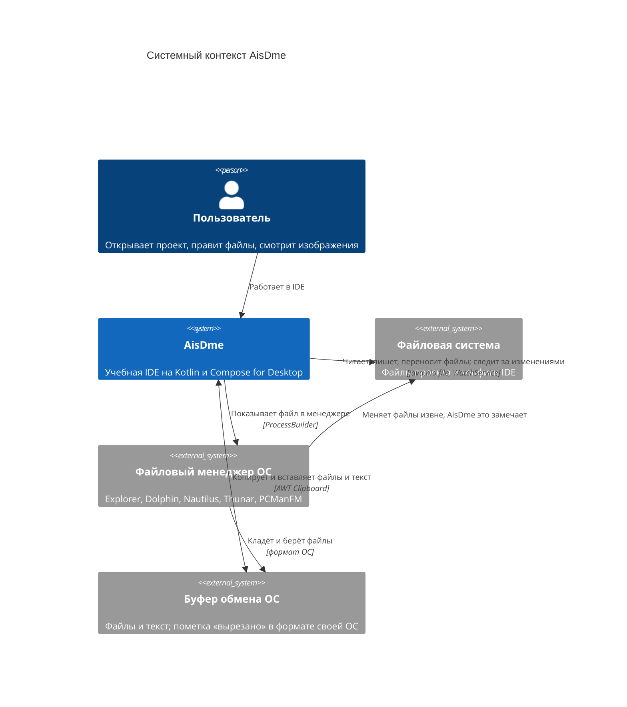
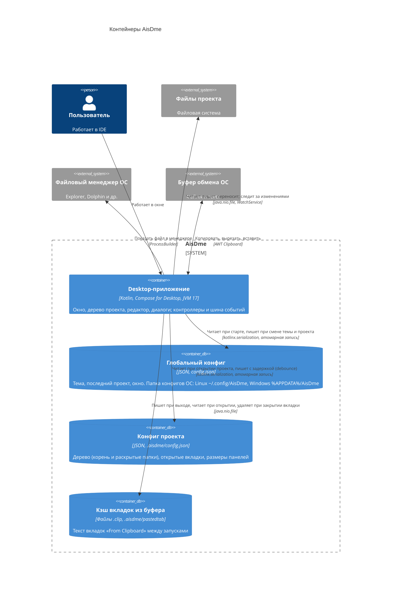
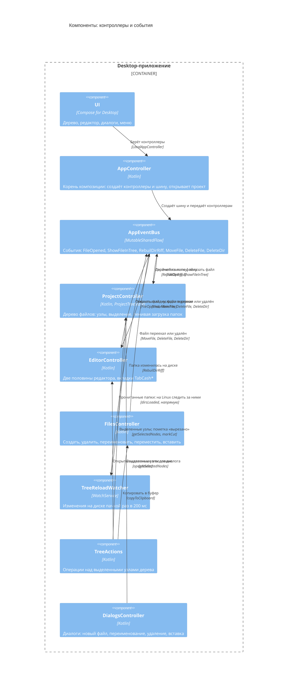
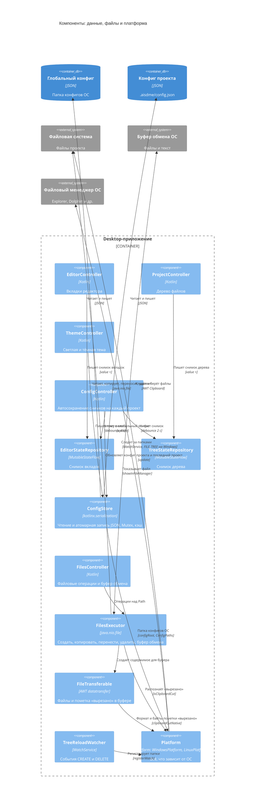
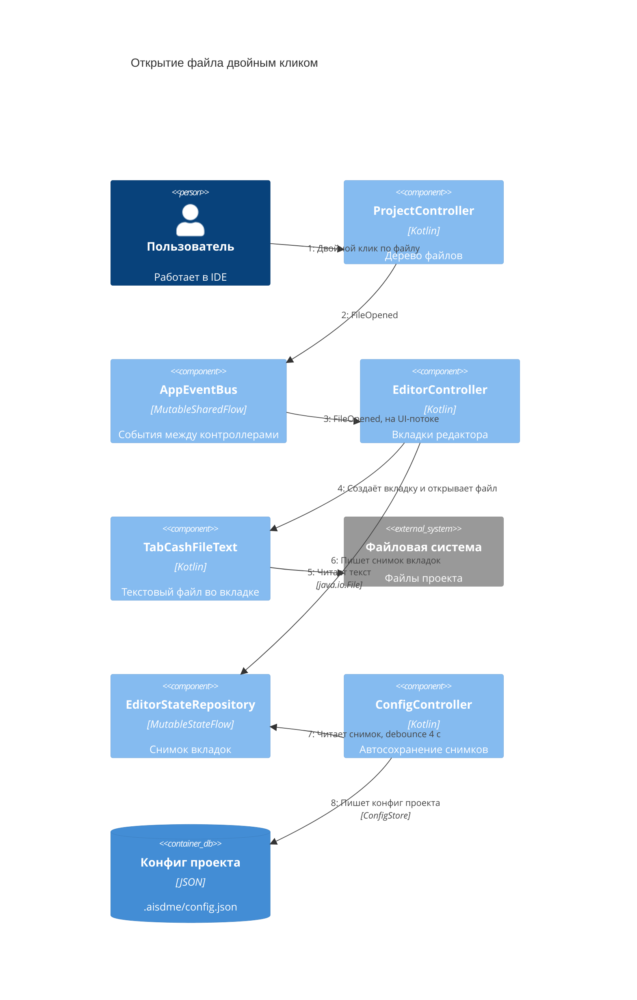
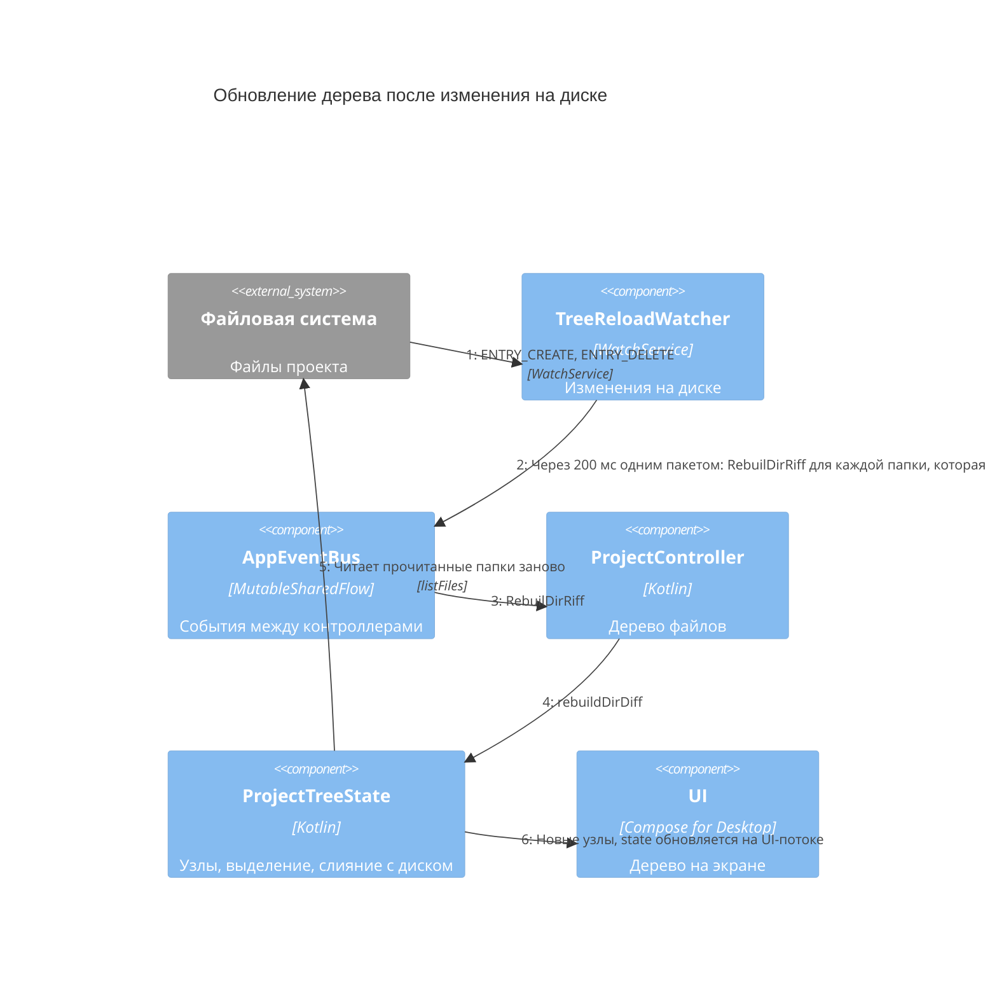

# Архитектура AisDme в диаграммах

Описание архитектуры по [C4 Model](https://c4model.com/): от системы целиком до компонентов внутри приложения. Диаграммы нарисованы в Mermaid, GitHub показывает их прямо в тексте. Они описывают код на 2026-11-07, а не целевую архитектуру. Уровень 4 (Code) не рисуется: классы смотрятся в IDE.

Текстовое описание компонентов — в [docs/ai/architecture.md](ai/architecture.md), причины решений — в [docs/ai/decisions.md](ai/decisions.md).

Обозначения на всех диаграммах:

| Элемент | Что это |
|---|---|
| Person | человек, пользователь IDE |
| System | AisDme целиком |
| System_Ext | внешняя система, не часть приложения |
| Container, ContainerDb | отдельно запускаемое приложение или хранилище данных |
| Component | класс или группа классов внутри приложения |
| Стрелка с подписью | кто кого вызывает или читает; под подписью — технология |

## 1. System Context

Кто пользуется AisDme и с чем она связана вне себя.

## 2. Container

Приложение — один процесс JVM. Всё остальное — данные на диске: два конфига и кэш вкладок «из буфера обмена».

## 3. Component

Приложение разбито на две диаграммы: на одной контроллеры и события между ними, на другой данные, файлы и всё, что зависит от ОС. Одна диаграмма со всеми компонентами получилась бы перегруженной.

Чего на диаграммах нет:

- Compose UI показан одним элементом: экраны получают контроллеры через `LocalAppController`.
- `AppController` создаёт все контроллеры и передаёт им шину. Стрелки к каждому не рисуются.
- `UiController` — абстрактный предок контроллеров (корутины и поток сообщений), отдельным компонентом не показан. `GlobalMessages` подписывается на сообщения всех контроллеров (`collectFrom`) и показывает их в `ErrorOverlay`.
- `MoveController` (состояние drag & drop) связан только с UI и нигде не показан.

### 3.1 Контроллеры и события

### 3.2 Данные, файлы и платформа

## 4. Dynamic

### 4.1 Открытие файла из дерева

Двойной клик по файлу открывает вкладку, а состояние редактора попадает в конфиг проекта.

### 4.2 Изменение на диске извне

Файл создали в файловом менеджере: дерево обновляется без действий пользователя. На Windows watcher следит за всем деревом одним ключом, на Linux — только за корнем и папками, прочитанными в дерево.

## Расхождения с решениями

- **«Контроллеры общаются через шину».** В [docs/ai/architecture.md](ai/architecture.md) это сказано без оговорок. По коду шина — основной, но не единственный путь:
  - прочитанные папки дерева идут в watcher напрямую (`ProjectTreeState.onDirsLoaded` → `TreeReloadWatcher.dirsLoaded`, связка в `AppController`). Это решение записано в [decisions.md](ai/decisions.md), «Ленивая загрузка дерева проекта»: шина при переполнении теряла события;
  - `TreeActions` и `DialogsController` вызывают контроллеры напрямую.
- **`UiController`** в issue [#35](https://github.com/efimov-r/aisdme/issues/35) назван контроллером. По коду это абстрактный предок: корутины и поток сообщений для всех контроллеров. Отдельным компонентом он не нарисован.
- **Сообщения об ошибках** на схемах не показаны: каждый контроллер отдаёт их в `GlobalMessages`, а он показывает в `ErrorOverlay`. Это сквозная связь, она перегрузила бы диаграммы.
