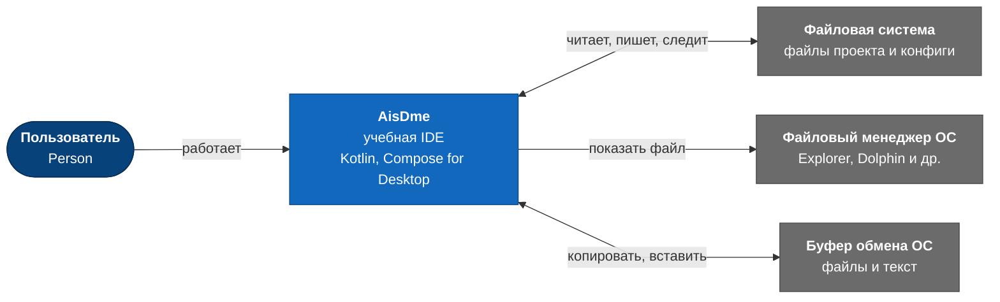
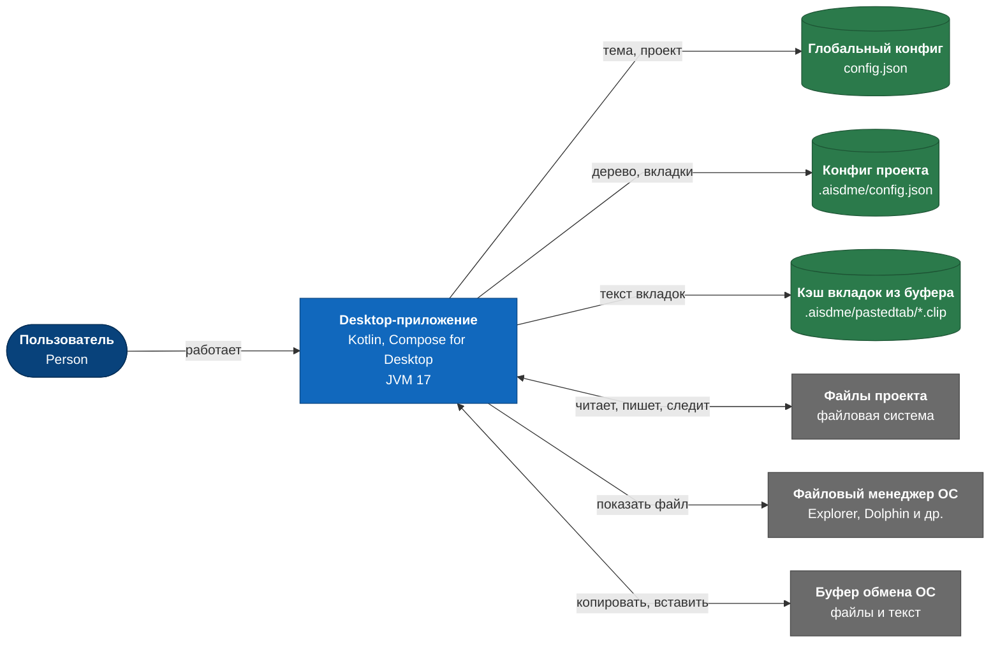
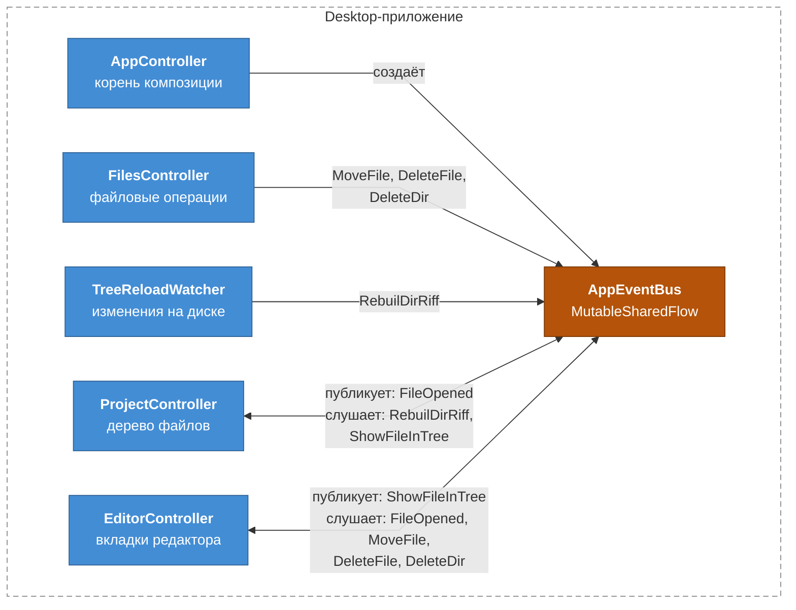
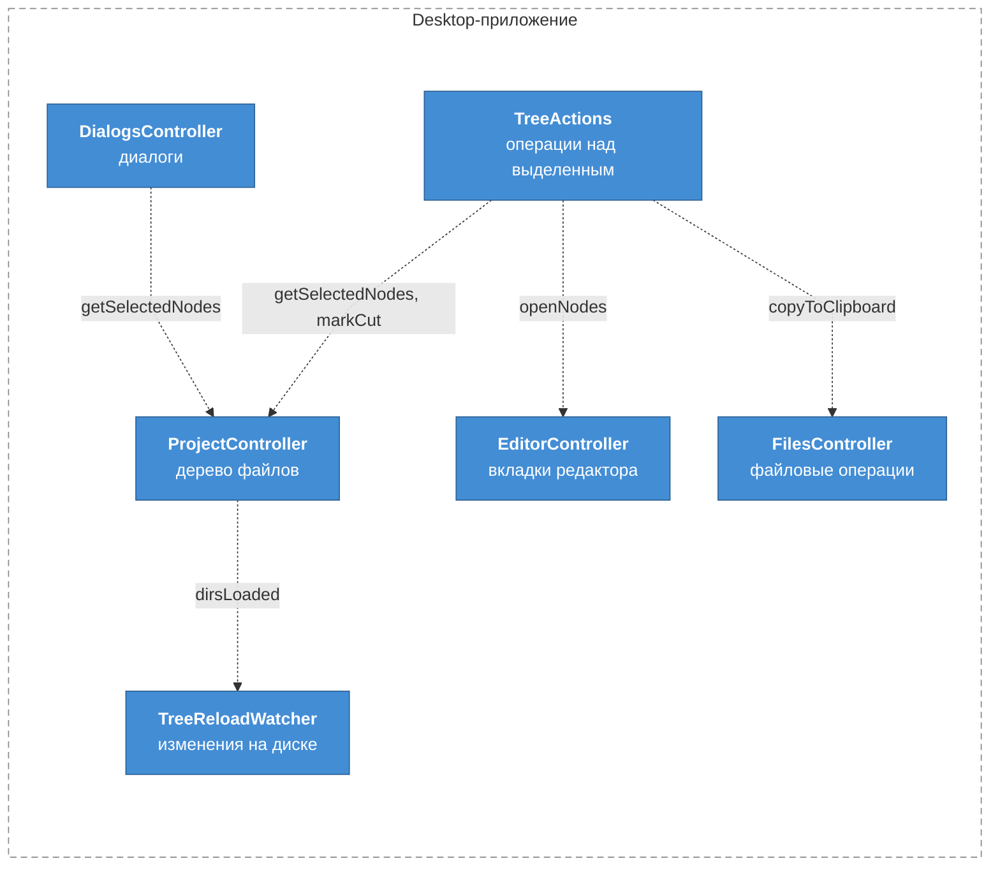
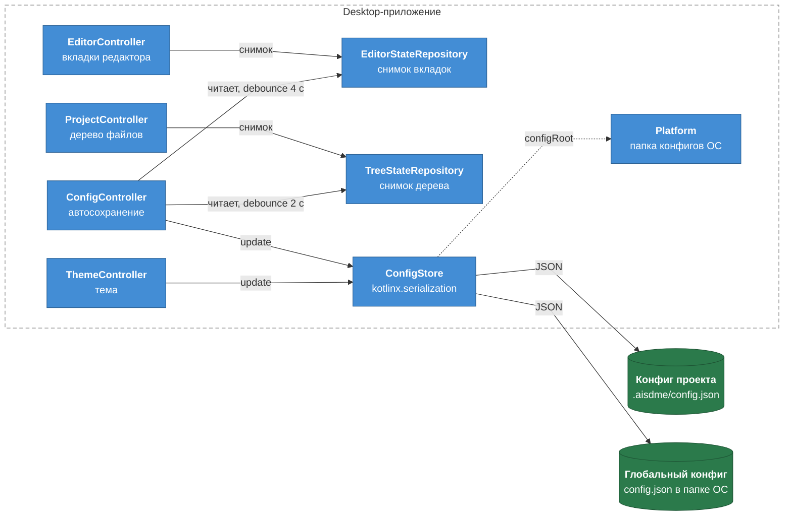
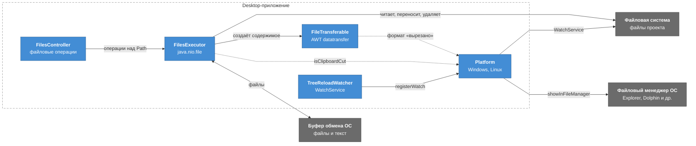
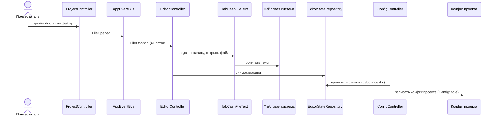
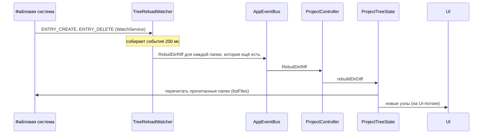

# Архитектура AisDme в диаграммах

Описание архитектуры по [C4 Model](https://c4model.com/): от системы целиком до компонентов внутри приложения. Диаграммы нарисованы в Mermaid (`flowchart` и `sequenceDiagram`): GitHub показывает их прямо в тексте. Родной синтаксис C4 в Mermaid не раскладывает элементы сам и клал подписи связей друг на друга, поэтому уровни и типы элементов C4 сохранены, а рисуются они обычными диаграммами. Диаграммы описывают код на 2026-11-07, а не целевую архитектуру. Уровень 4 (Code) не рисуется: классы смотрятся в IDE.

Текстовое описание компонентов — в [docs/ai/architecture.md](ai/architecture.md), причины решений — в [docs/ai/decisions.md](ai/decisions.md).

Обозначения на схемах:

| Вид | Что это |
|---|---|
| тёмно-синий овал | человек, пользователь IDE |
| синий прямоугольник | система AisDme или её контейнер |
| серый прямоугольник | внешняя система, не часть AisDme |
| голубой прямоугольник | компонент внутри приложения |
| зелёный цилиндр | хранилище данных на диске, часть AisDme |
| оранжевый прямоугольник | шина событий `AppEventBus` |
| сплошная стрелка | вызов, чтение, запись или событие через шину |
| пунктирная стрелка | прямой вызов между компонентами, не через шину |
| стрелка с двумя остриями | данные идут в обе стороны |

## 1. System Context

Кто пользуется AisDme и с чем она связана вне себя.

| Связь | Технология |
|---|---|
| AisDme ↔ файловая система | `java.nio.file`, `WatchService` |
| AisDme → файловый менеджер | `ProcessBuilder` |
| AisDme ↔ буфер обмена | AWT `Clipboard`, пометка «вырезано» в формате ОС |

Файловый менеджер и AisDme общаются не напрямую: менеджер меняет файлы на диске (AisDme замечает это через `WatchService`) и кладёт файлы в буфер обмена, откуда AisDme их вставляет, в том числе с пометкой «вырезано».

## 2. Container

Приложение — один процесс JVM. Всё остальное — данные на диске: два конфига и кэш вкладок «из буфера обмена». Зелёные хранилища принадлежат AisDme, серые системы — внешние.

| Связь | Когда | Технология |
|---|---|---|
| приложение → глобальный конфиг | читает при старте; пишет при смене темы и открытии проекта. Содержит тему, последний проект, окно | `kotlinx.serialization`, атомарная запись |
| приложение → конфиг проекта | читает при открытии проекта; пишет с задержкой (debounce). Содержит дерево (корень и раскрытые папки), открытые вкладки, размеры панелей | `kotlinx.serialization`, атомарная запись |
| приложение → кэш вкладок | пишет при выходе, читает при открытии, удаляет при закрытии вкладки | `java.nio.file` |
| приложение ↔ файлы проекта | читает, пишет, переносит, следит за изменениями | `java.nio.file`, `WatchService` |
| приложение → файловый менеджер | показать файл | `ProcessBuilder` |
| приложение ↔ буфер обмена | копировать, вырезать, вставить | AWT `Clipboard` |

Папка глобального конфига: Linux — `~/.config/AisDme`, Windows — `%APPDATA%/AisDme`.

## 3. Component

Приложение показано четырьмя диаграммами: события через шину, прямые вызовы, конфиги и состояние, файлы и платформа. Одна диаграмма со всеми компонентами получилась бы перегруженной.

Чего на диаграммах нет:

- Compose UI: экраны получают контроллеры через `LocalAppController`.
- Стрелок от `AppController` к каждому контроллеру: он создаёт их все и передаёт им шину. На диаграмме шины показана только его связь с самой шиной.
- `UiController` — абстрактный предок контроллеров (корутины и поток сообщений), отдельным компонентом не показан. `GlobalMessages` подписывается на сообщения всех контроллеров (`collectFrom`) и показывает их в `ErrorOverlay`.
- `MoveController` (состояние drag & drop) связан только с UI и нигде не показан.

### 3.1 Контроллеры и события

| Событие | Кто публикует | Кто слушает | Зачем |
|---|---|---|---|
| `FileOpened` | `ProjectController` | `EditorController` | двойной клик по файлу: открыть вкладку |
| `ShowFileInTree` | `EditorController` | `ProjectController` | показать файл вкладки в дереве |
| `RebuilDirRiff` | `TreeReloadWatcher` | `ProjectController` | папка изменилась на диске: перечитать |
| `MoveFile`, `DeleteFile`, `DeleteDir` | `FilesController` | `EditorController` | файл переехал или удалён: обновить или закрыть вкладки |

### 3.2 Прямые вызовы

Связи, которые идут не через шину. Пунктир — вызов метода.

| Вызов | Зачем |
|---|---|
| `TreeActions` → `ProjectController` | выделенные узлы; пометка «вырезано» |
| `TreeActions` → `EditorController` | открыть выделенные файлы в левой или правой половине |
| `TreeActions` → `FilesController` | положить выделенные файлы в буфер обмена |
| `DialogsController` → `ProjectController` | выделенные узлы для диалога (функция из `AppController`) |
| `ProjectController` → `TreeReloadWatcher` | `dirsLoaded`: прочитанные папки дерева, на Linux watcher следит только за ними |

Связка `dirsLoaded` сделана в `AppController`, потому что шина при переполнении теряла события.

### 3.3 Конфиги и состояние

Репозитории — `MutableStateFlow`, в них пишут присваиванием `value`. `ConfigStore` пишет JSON атомарно, под `Mutex`, с кэшем.

### 3.4 Файлы, буфер обмена и платформа

`Platform` — интерфейс `IPlatform` с реализациями `WindowsPlatform` и `LinuxPlatform`. На Windows `WatchService` регистрирует корень с `FILE_TREE`.

## 4. Dynamic

### 4.1 Открытие файла из дерева

Двойной клик по файлу открывает вкладку, а состояние редактора попадает в конфиг проекта.

### 4.2 Изменение на диске извне

Файл создали в файловом менеджере: дерево обновляется без действий пользователя. На Windows watcher следит за всем деревом одним ключом, на Linux — только за корнем и папками, прочитанными в дерево.

## Расхождения с решениями

- **«Контроллеры общаются через шину».** В [docs/ai/architecture.md](ai/architecture.md) это сказано без оговорок. По коду шина — основной, но не единственный путь:
  - прочитанные папки дерева идут в watcher напрямую (`ProjectTreeState.onDirsLoaded` → `TreeReloadWatcher.dirsLoaded`, связка в `AppController`). Это решение записано в [decisions.md](ai/decisions.md), «Ленивая загрузка дерева проекта»: шина при переполнении теряла события;
  - `TreeActions` и `DialogsController` вызывают контроллеры напрямую.
- **`UiController`** в issue [#35](https://github.com/efimov-r/aisdme/issues/35) назван контроллером. По коду это абстрактный предок: корутины и поток сообщений для всех контроллеров. Отдельным компонентом он не нарисован.
- **Сообщения об ошибках** на схемах не показаны: каждый контроллер отдаёт их в `GlobalMessages`, а он показывает в `ErrorOverlay`. Это сквозная связь, она перегрузила бы диаграммы.
